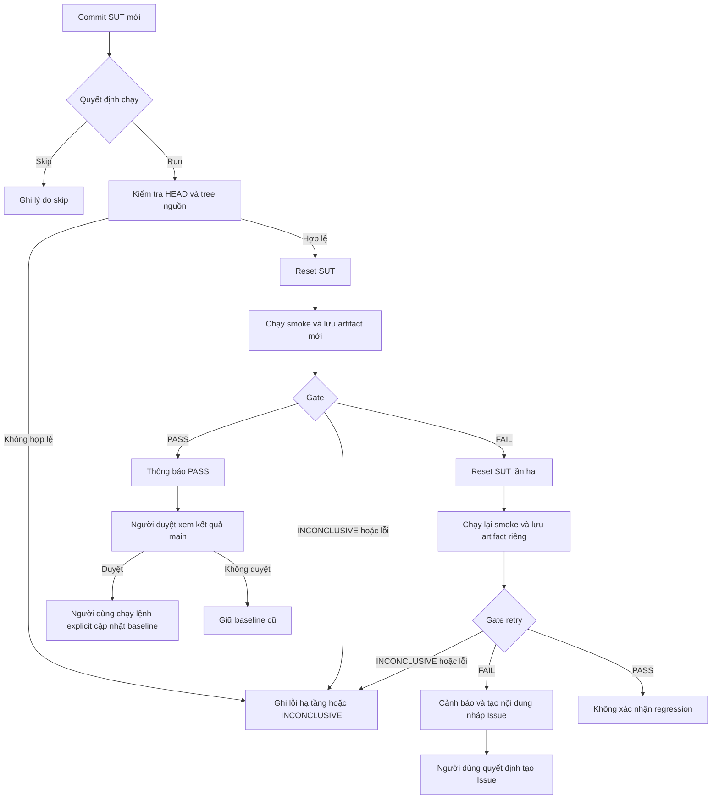

# Bước 30 – Đề xuất Continuous Performance Testing

## 1. Mục tiêu và phạm vi

Theo dõi từng commit của repo Git riêng `eshop-sut`, quyết định có đo và phát hiện suy giảm p95 so với baseline tương thích, đồng thời kiểm tra SLO tuyệt đối và lỗi. Workflow API Flow 1 gồm `01 Login`, `02 Products`, `03 Product detail`, `04 Add cart`, `05 Get cart`, `06 Checkout`, `07 My orders` và `Negative login` khoảng 5%. Kết quả không đại diện hiệu năng UI hay các route ngoài workflow. Phân loại diff dựa trên [bản đồ thay đổi](16a_sut_change_map.md); ngưỡng dựa trên [Task 2 §4](TASK2_REPORT.md#4-ngưỡng-cuối-cùng).

## 2. Quyết định chạy

So sánh path trong diff giữa base và commit ứng viên, kể cả path cũ và mới khi đổi tên; phân loại theo thứ tự trong bản đồ, không dùng inventory 66 file như allowlist đóng:

1. Message có `[perf]` → **run**, kể cả khi cũng có `[skip perf]`. Nếu không có `[perf]` mà có `[skip perf]` → **skip**, ghi marker và lý do; override cả thay đổi backend, nên người dùng chịu rủi ro bỏ sót.
2. Có path B ảnh hưởng backend → run: `backend/**/*.js`, `backend/package.json`, `backend/package-lock.json`, `run_servers.sh`.
3. Chỉ có path N → skip và ghi lý do: `frontend-admin/**`, `frontend-mobile/**`, `frontend-web/**`, hoặc Markdown; đây chỉ là không ảnh hưởng workload API cố định.
4. Có path U chưa rõ → run, kể cả khi các path còn lại là N. Mọi path chưa khớp là U; `backend/database.sqlite` là U.

Thứ tự phân loại path cụ thể trong [16a §2](16a_sut_change_map.md#2-chính-sách-phân-loại-file) ưu tiên backend trước Markdown. Seed trong `backend/database.js` là B, seed file mới chưa phân loại là U; thay seed hoặc môi trường bên ngoài repo không xuất hiện trong diff có thể bị bỏ sót. Frontend có thể đổi request mix thực tế dù không đổi workload cố định. Marker skip cũng có thể bỏ sót thay đổi thật; test theo lịch giảm rủi ro nhưng không chứng minh bao phủ đầy đủ.

## 3. Các tầng test và chi phí dự kiến

Chạy JMeter non-GUI, reset bằng `scripts/reset_sut.sh` trước **mỗi** lượt, kể cả retry và mỗi plan trong tầng tuần. Mỗi lượt tạo JTL và HTML ở đường dẫn mới, không nối hoặc ghi đè kết quả cũ. Thời gian dưới đây là **ước tính theo scheduler JMX**, không phải số đo thời gian máy; ramp nằm trong duration, cộng thêm reset, khởi động, kết thúc request và xử lý report chưa đo.

| Tầng | Lịch và profile | Thời gian chạy cấu hình, chưa kể overhead |
|---|---|---:|
| 1 | Mỗi commit được chọn: `23120190_Load_20261117.jmx`, `-Jthreads=30 -Jrampup=15 -Jduration=180` | 180 s = 3 phút/lượt; retry thêm 3 phút |
| 2 | Hằng đêm: cùng Load plan, 50 VU, ramp mặc định 50 s, duration 600 s | 600 s = 10 phút/lượt |
| 3 | Hằng tuần hoặc trước release: Stress, Spike, Soak lần lượt | Stress 4 stage nối tiếp × 150 s = 600 s; Spike chạy song song baseline 360 s và spike delay 120 s + duration 120 s → 360 s; Soak 720 s. Tổng 1.680 s = 28 phút, cộng ba lần reset và overhead |

Tầng đêm/tuần dùng profile và baseline được phê duyệt riêng; không so với smoke. Nếu chưa có baseline tương thích, relative gate là INCONCLUSIVE. SLO/đánh giá cho các profile khác cần giữ đúng phạm vi và cửa sổ của từng plan; không giả định một ngưỡng throughput chứng minh sức chịu tải mọi tầng.

## 4. Gate và retry

Dùng `scripts/jtl_truth.py` (`load_jtl()`, `metrics()`, nearest-rank) trên JTL thật. So sánh bảy label chính riêng rẽ, elapsed p95 và p99; loại Negative login khỏi latency Login. Dùng cùng workflow, profile, cửa sổ sau ramp, bộ lọc và hardware giữa hai run. Chọn **N = 500 sample mỗi label mỗi run** (`--min-samples` mặc định 500), đồng thời so sánh relative cần **ít nhất 1.000 sample main tổng mỗi run**, theo yêu cầu ≥ 1.000 sample mỗi run của Task 2. Đây là chính sách chọn trước demo, không nới sau FAIL. JTL Load thật có 33.534 sample main: phép ngoại suy thô `(33534/7) × (30/50) × (180/600) ≈ 862` sample/label smoke trước ảnh hưởng ramp/think time; không bảo đảm tuyến tính hay dự báo số thực. Với 500 mẫu, p95 chỉ có khoảng 25 quan sát đuôi và p99 khoảng 5, nên p99 nhiễu; dùng retry và tầng dài hơn. Không suy ra profile từ sample count.

| Label | SLO p95 / p99 tối đa (ms) |
|---|---:|
| 01 Login | 75 / 125 |
| 02 Products | 75 / 125 |
| 03 Product detail | 75 / 125 |
| 04 Add cart | 50 / 100 |
| 05 Get cart | 50 / 100 |
| 06 Checkout | 100 / 150 |
| 07 My orders | 75 / 125 |

- **REGRESSION:** với label đủ N và tổng main ≥ 1.000 ở cả hai run, p95 mới **> 1,20 ×** p95 baseline **và** chênh lệch **≥ 5 ms**.
- **SLO FAIL:** p95 hoặc p99 label đủ N vượt tối đa trong bảng. Đó là ngưỡng chính sách, chưa được kiểm chứng thống kê.
- **ERROR FAIL:** tỷ lệ `success=false` > 0,1%, mẫu số là tất cả sample (`all`), toàn run và từng cửa sổ 120 s sau ramp theo Task 2. Theo dõi thêm `main` = lỗi trên bảy label chính / tổng sample bảy label chính, cùng response code và kiểm tra nghiệp vụ; không thay mẫu số SLO all. Negative login 401/403 được assertion chấp nhận là success, không được tính nhầm thành lỗi hoặc đưa vào latency Auth.
- Label thiếu N → **INCONCLUSIVE**, không tự FAIL; baseline thiếu N, tổng main dưới 1.000 mỗi run cho relative comparison, metadata không đủ hoặc không tương thích cũng làm so sánh tương ứng INCONCLUSIVE. Một FAIL thực sự ở label đủ mẫu hoặc error gate không bị label thiếu mẫu che đi. Không có FAIL nhưng còn điều kiện chưa đánh giá được → INCONCLUSIVE, không PASS. Lỗi hạ tầng cũng không phải PASS.
- Với FAIL, reset và chạy lại một lần cùng profile trên đúng commit, lưu artifact riêng. Chỉ **FAIL cả hai lượt** mới xác nhận và gửi cảnh báo/nháp Issue; FAIL rồi PASS không xác nhận regression. Nếu retry INCONCLUSIVE hoặc lỗi hạ tầng, báo đúng trạng thái chưa kết luận, không gọi PASS. Gate xuất mã 0 PASS, 1 FAIL, 2 INCONCLUSIVE; trạng thái lỗi hạ tầng phải được ghi riêng, không giả làm PASS.

Task 2 còn nêu throughput ≥ 200 request/s ở tải mục tiêu theo cửa sổ 120 s sau ramp; đó là chỉ tiêu theo dõi ở tải phù hợp, không áp đặt vào smoke 30 VU như điều kiện gate trên.

## 5. Baseline

Baseline smoke là kết quả smoke của commit `main` gần nhất **đã PASS và được người duyệt chọn**, lưu `results/cpt/baseline.json`; không tự cập nhật sau mỗi PASS. Người duyệt thực hiện lệnh tạo baseline explicit `--make-baseline` ngoài pipeline sau khi kiểm tra kết quả. Bootstrap lần đầu chỉ tạo khi đủ mẫu, SLO tuyệt đối và error đạt; chưa có baseline thì không gọi đó là đã vượt relative gate. Baseline đêm/tuần có profile và file riêng, cũng phải được duyệt.

Lưu metadata cùng JTL bằng sidecar do pipeline/lệnh tạo baseline ghi: SUT commit, máy được nhận diện bằng hostname/platform/architecture, workflow, plan và profile thực tế (threads, ramp, duration và tham số liên quan), cửa sổ sau ramp, bộ lọc và các fingerprint plan/CSV. So sánh các thuộc tính tương thích trước gate; thiếu thông tin cần thiết hoặc khác nhau → INCONCLUSIVE. Các dấu nhận diện này không chứng minh CPU/RAM, phiên bản Java/JMeter/Node hay tải nền hoàn toàn giống nhau; người vận hành phải giữ môi trường cố định. Caller checkout đúng commit SUT trước khi chạy; pipeline kiểm tra HEAD và tree nguồn có thay đổi chưa commit, không tự checkout. DB runtime đã thay đổi và `node_modules` untracked là state sẵn có cần ghi nhận và xử lý theo chính sách runtime, không stash/restore/xóa; không được để thay đổi source chưa commit hoặc sai HEAD làm phép đo tưởng thuộc commit khác.

## 6. Luồng tự động và người duyệt

Các nút đến cảnh báo là tự động; nháp không phải Issue đã tạo. Phê duyệt, lệnh cập nhật baseline và tạo Issue là hành động của người dùng, ngoài pipeline. Mermaid đã render bằng `npx -y @mermaid-js/mermaid-cli` với Chrome `/usr/bin/google-chrome` và `--no-sandbox`, exit 0; executor đã xem SVG và xác nhận các nhánh/nhãn hiển thị, rồi xóa file tạm.

## 7. Vai trò AI – G9.6

AI có thể đọc diff để gợi ý tầng test, tóm tắt kết quả và soạn nháp Issue kèm commit, profile, artifact và gate. Luật quyết định và phép đo vẫn xác định bằng dữ liệu thật; AI không thay thế gate. AI không tự cập nhật baseline: một baseline sai hoặc nhiễu có thể hợp thức hóa regression. AI không tự đóng cảnh báo: cần người kiểm tra bằng chứng, retry và tác động thực tế, tránh che lỗi hoặc đóng nhầm.

## 8. Trade-off

| Trade-off | Rủi ro / chi phí | Giảm thiểu |
|---|---|---|
| Chi phí | Ước tính scheduler: mỗi commit được chọn 3 phút, có retry 6 phút; mỗi đêm 10 phút; mỗi tuần 28 phút. Công thức tổng = 3 × số commit chạy + 3 × số retry + 10 × số đêm + 28 × số tuần, phút; chưa tính reset, report, xếp hàng hay chạy release thêm. | Lọc diff, serialize SUT, dùng runner cố định; đo overhead thực tế trước khi lập ngân sách. |
| Báo động giả | Máy dùng chung và nhiễu có thể gây spike dù không đổi code; [Task 2 §2](TASK2_REPORT.md) có cửa sổ Soak 120–240 s p95 all 1.013 ms. [Demo A/A](17_cpt_demo.md): 0 cảnh báo trong 1 lần so sánh, độ lệch p95 tuyệt đối tối đa 6 ms tại Checkout theo chiều giảm; một cặp chưa ước lượng được tỷ lệ báo động giả quần thể. | Cùng máy/profile/filter, cô lập tải và retry sau reset; A/A kiểm tra độ nhiễu, không xem một spike là nguyên nhân đã chứng minh. |
| Bỏ sót | Smoke ngắn không xác lập rò rỉ RAM dài hạn; `userCarts` giữ entry sau checkout, nhưng RSS tăng trong Soak chỉ phù hợp với giả thuyết giữ state, không chứng minh leak vô hạn hay quan hệ nhân quả ([08](08_endurance.md)). | Soak dài định kỳ, theo dõi RSS và state, điều tra nguyên nhân; mở rộng workflow khi cần. |
| Độ trễ phản hồi dev | Smoke cần ít nhất thời lượng cấu hình 3 phút cộng overhead, hoặc hai lượt khi FAIL; các tầng sâu chờ lịch. | Báo trạng thái sớm, chạy smoke trước và các tầng đêm/tuần bất đồng bộ. |
| Baseline bị trôi | Cập nhật liên tục hoặc so sai profile có thể biến regression thành chuẩn mới. | Lưu commit/metadata, kiểm tra tương thích, cần người duyệt và lệnh explicit; giữ lịch sử artifact để đối chiếu. |
