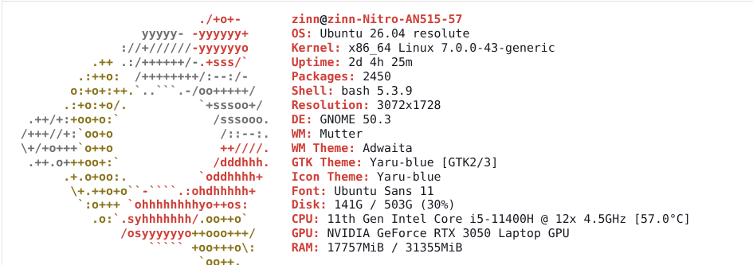
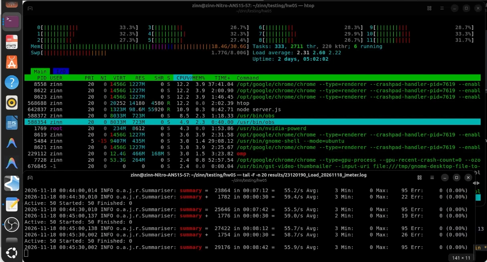
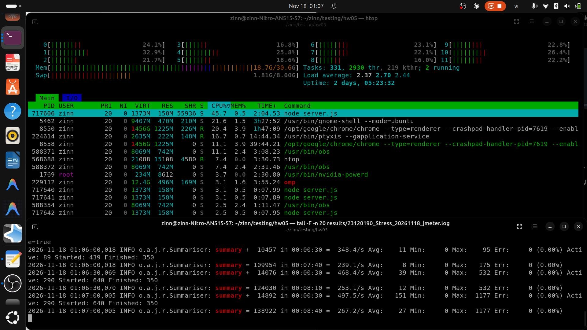
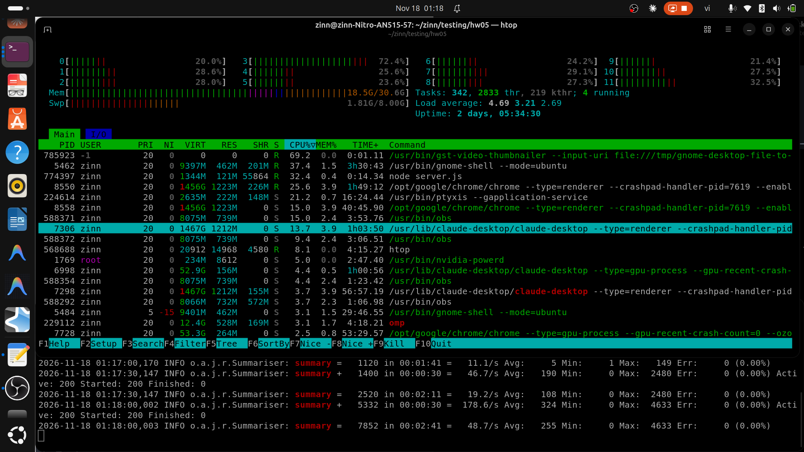
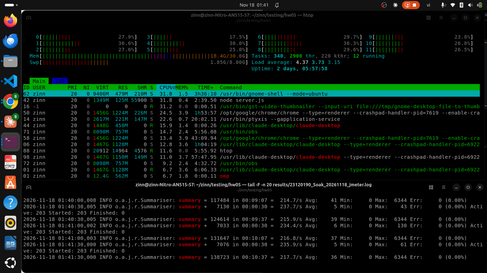
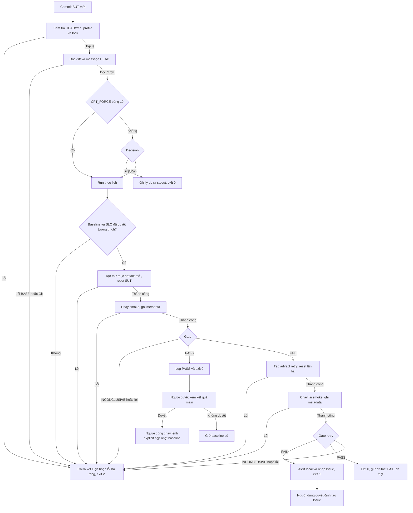

# HW05 – Performance Testing: Báo cáo chính

Sinh viên **23120190** · Flow 1 (login → products → product detail → cart → checkout → my-orders) · Repo: https://github.com/tzin1401/testing-hw05

| Phần | Nội dung |
|---|---|
| 1 | Task 1 – Load / Stress / Spike / Soak |
| 2 | Bug report |
| 3 | Task 2 – Phân tích AI và misinterpretation hunt |
| 4 | Task 3 – Continuous Performance Testing |
| 5 | Agent Skill |
| 6 | AI Critique |

Video demo: Load https://youtu.be/gI2pvrCkcQg · Stress https://youtu.be/1ZFqomMaMFU · Spike https://youtu.be/qH1VOzb8fZU · Soak https://youtu.be/ADsnkwwEeRE

AI Audit Report: [AI_AUDIT_REPORT.md](AI_AUDIT_REPORT.md) · Toàn văn log: [AI_LOG.md](AI_LOG.md)


# 1. Task 1 – Kiểm thử hiệu năng

### 1. Môi trường và phần cứng

Theo [báo cáo phần cứng](05_hardware.md), máy dùng Ubuntu 26.04.1 LTS, Intel Core i5-11400H, 6 nhân / 12 luồng, RAM 30 GiB; JMeter 5.6.3 và Node.js v22.22.1. [Kiểm tra môi trường](00_environment.md) ghi Java mặc định 25 nhưng các lần đo dùng Java 17. JMeter và SUT cùng máy nên có thể tranh chấp tài nguyên; không suy ra năng lực production từ cấu hình này ([thiết kế](02_test_design.md)).



### 2. Workflow và độ phủ

Tất cả plan dùng Flow 1, dữ liệu tài khoản và sản phẩm từ [data](../data/README.md). Chi tiết request, token và assertion ở [phân tích API](01_api_analysis.md) và [thiết kế](02_test_design.md).

| Nhóm | Các endpoint theo thứ tự workflow |
|---|---|
| Auth | `POST /api/login` |
| Read | `GET /api/products` → `GET /api/products/{id}` |
| Transactional | `POST /api/cart` → `GET /api/cart` → `POST /api/checkout` → `GET /api/orders/my-orders` |

### 3. Thiết kế kịch bản

Thông số cấu hình, không phải năng lực đo được: [thiết kế](02_test_design.md).

| Kịch bản | VU / ramp / thời lượng | Think-time | Listener | Plan |
|---|---|---|---|---|
| Load | 50 VU; ramp 50 s; 600 s gồm ramp | 500–1500 ms | Summary Report | [JMX](../test-plans/23120190_Load_20261117.jmx) |
| Stress | Các bậc tuần tự 50, 100, 200, 290 VU; mỗi bậc ramp 30 s, dài 150 s | 250–750 ms | Aggregate Report | [JMX](../test-plans/23120190_Stress_20261117.jmx) |
| Spike | Nền 10 VU / 360 s / ramp 10 s; thêm 190 VU từ giây 120 đến 240, ramp 5 s | 500–1500 ms | Response Time Graph | [JMX](../test-plans/23120190_Spike_20261117.jmx) |
| Soak bổ sung | 203 VU; ramp 60 s; 720 s gồm ramp | 500–1500 ms | Simple Data Writer | [JMX](../test-plans/23120190_Soak_20261118.jmx) |

### 4. AI sai gì và đã sửa gì

Đây là tổng hợp review kỹ thuật của AI, **không thay cho đánh giá của sinh viên**. [Review Load](03_review_load.md) chỉ ra thiếu keep-alive, assertion giỏ có thể khớp item cũ, thiếu pause khi login lỗi và nguy cơ lệch giữa assertion và extractor; [smoke sau sửa](03a_load_fixed_smoke.md) ghi bằng chứng kiểm tra. [Review Stress/Spike](04_review_stress_spike.md) ghi các sửa kế thừa và lỗi `props.get(key, default)` của Groovy có thể ghi default vào properties, thay bằng `getProperty`; [smoke ban đầu](04a_stress_spike_initial_smoke.md), [smoke sau sửa](04b_stress_spike_fixed_smoke.md) và [smoke toàn plan](05a_all_plans_smoke.md) là nguồn bổ sung. Java 25 gặp lỗi tương thích Groovy; dùng Java 17 theo [review](04_review_stress_spike.md) và [môi trường](00_environment.md). Xem riêng [human review do sinh viên viết](06_human_review.md); báo cáo này không điền hoặc suy diễn sự chấp thuận của sinh viên.

Tổng p95 Soak che khuất một phút vượt tiêu chí: xem [phân tích theo phút](08_endurance.md). Trong bước bug report, kết luận checkout/cart HTTP 200 ban đầu không có bằng chứng vì raw cũ thực tế trả 403; Manager sửa quy trình và thu [curl HTTP 200 thực tế](../results/repro/checkout_cart_20261118.txt), xem [bug report](09_bugs.md).

### 5. Kết quả chạy

Bảng dùng entry `Total` của từng statistics JSON, làm tròn RPS đến ba chữ số thập phân. Total gồm cả `Negative login` được assertion chấp nhận; các mẫu luồng chính đều không lỗi theo [run log và phân loại JTL](07_run_log.md). p95 là `pct2ResTime` của HTML, đơn vị ms.

| Run | Tổng samples | Error | p95 ms | RPS | Nguồn JSON | HTML | JTL canonical |
|---|---:|---:|---:|---:|---|---|---|
| Load | 33,775 | 0% | 11 | 56.344 | [JSON](../results/html/23120190_Load_20261118/statistics.json) | [HTML](../results/html/23120190_Load_20261118/index.html) | [JTL](../results/jtl/23120190_Load_20261118.jtl) |
| Stress | 175,882 | 0% | 1,023 | 293.092 | [JSON](../results/html/23120190_Stress_20261118/statistics.json) | [HTML](../results/html/23120190_Stress_20261118/index.html) | [JTL](../results/jtl/23120190_Stress_20261118.jtl) |
| Spike | 27,965 | 0% | 17 | 77.926 | [JSON](../results/html/23120190_Spike_20261118/statistics.json) | [HTML](../results/html/23120190_Spike_20261118/index.html) | [JTL](../results/jtl/23120190_Spike_20261118.jtl) |
| Soak | 158,591 | 0% | 21 | 220.332 | [JSON](../results/html/23120190_Soak_20261118/statistics.json) | [HTML](../results/html/23120190_Soak_20261118/index.html) | [JTL](../results/jtl/23120190_Soak_20261118.jtl) |

HTML Stress gốc đã được JMeter tạo thành công. Worker từng hiểu nhầm thông báo INFO là lỗi; `_recovered` là bản xuất lại từ cùng JTL để đối chiếu, không phải chạy tải lại. Writer phụ Soak ghi cùng sự kiện nên không cộng hai lần; xem [run log](07_run_log.md).

### 6. Lockout và reset

Theo [bằng chứng curl](../results/repro/flow1_bugs_20261118.txt) và [bug report](09_bugs.md), hai lần sai đều trả 401; mật khẩu đúng vẫn trả 403 ở khoảng 35 và 179 giây, đến khoảng 181 giây trả 200. Không diễn giải phép đo thành mốc chính xác tuyệt đối. Plan tách tài khoản login sai, chấp nhận 401/403 theo assertion; trước **mỗi** lần chạy reset bằng [script](../scripts/reset_sut.sh), restart backend, xóa trạng thái DB/giỏ/lockout và seed tài khoản. Chỉ chờ hết khóa không thay reset ([thiết kế](02_test_design.md)).

### 7. Ngưỡng endurance

[JSON phân tích](../results/analysis/endurance.json) và [phương pháp, bảng theo phút](08_endurance.md) loại login sai khỏi luồng chính, dùng p95 nearest-rank và cửa sổ theo thời điểm bắt đầu mẫu. Stress sau ramp quan sát cao nhất **290 VU, 468.556 RPS, p95 947 ms, 0% lỗi**; chưa thấy ngưỡng vượt tiêu chí lỗi >5% hoặc p95 >2.000 ms trong các bậc đã thử. Đây không phải breakpoint hay năng lực tối đa được chứng minh trong 12 phút. Run log nêu **470.775 RPS** cho cửa sổ danh nghĩa khác, bắt đầu theo gate và chia 120 s; không đồng nhất với cửa sổ JSON sau 30 s từ mẫu đầu tiên của bậc ([run log](07_run_log.md), [phương pháp](08_endurance.md)).

Soak 203 VU có phút index 3 (180–240 s từ mẫu chính đầu tiên) **p95 2.244 ms, 171.183 RPS, 0% lỗi**, vượt tiêu chí 2.000 ms dù p95 tổng chỉ 21 ms. Không chứng minh ổn định liên tục suốt 12 phút hay xác định nguyên nhân episode. RSS cực đại quan sát được: Stress **171.64 MiB**, Soak **127.80 MiB**; độ dốc OLS Soak **1.470 MiB/phút**. Đây không phải trần RAM cứng hoặc bằng chứng quyết định của memory leak ([phân tích](08_endurance.md)).

### 8. Bug và issue

[Bản nháp bug](09_bugs.md) có **4 bug đã có bằng chứng**: 3 lỗi theo FR-02/FR-08 (lockout, checkout tin tổng tiền client, giỏ không xóa) và BUG-05 về mật khẩu plaintext theo SEC-01 (mục bảo mật tham khảo). Thêm **1 finding Low** về kiểu giá không nhất quán; spec chưa quy định rõ kiểu. [Raw lockout và giá](../results/repro/flow1_bugs_20261118.txt); [raw login/cart/checkout](../results/repro/checkout_cart_20261118.txt). Episode latency là quan sát riêng, không đếm thành bug chức năng. [API Issues](https://api.github.com/repos/tzin1401/testing-hw05/issues?state=all&per_page=100) trả `[]` lúc Manager kiểm tra; người dùng tự đăng tại [GitHub Issues](https://github.com/tzin1401/testing-hw05/issues) rồi bổ sung URL/ảnh. Agent không đăng.

### 9. Bằng chứng


[Ảnh kết quả Load](../evidence/load_result.png)


[Stress tại 200 VU](../evidence/stress_run_200.png) · [Kết quả Stress](../evidence/stress_result.png)


[Spike phục hồi](../evidence/spike_recovery.png) · [Kết quả Spike](../evidence/spike_result.png)


[Soak tại 6 phút](../evidence/soak_run_6m.png) · [Kết quả Soak](../evidence/soak_result.png)

### Việc sinh viên còn thực hiện

- Tự review kết quả và điền Human review các entry mới trong [AI log](AI_LOG.md); không sửa thay phần đánh giá cá nhân.
- Tự đăng Issues, chụp ảnh và bổ sung URL; cung cấp video YouTube unlisted ít nhất 6 phút, giọng thuyết minh tiếng Việt của mình theo [đề mục 6](../2026.HW05.Performance%20Testing_En.pdf).
- Điền điểm vào [README](../README.md), hoàn thành các phần ngoài phạm vi Task 1; xuất PDF báo cáo và AI critique/audit theo yêu cầu đề, rồi chuẩn bị bài nộp.
- Tự push repository công khai sau khi kiểm tra; hiện chưa thể coi bài nộp đầy đủ khi các thông tin và tác vụ của sinh viên còn thiếu.


# 2. Bug report

Ngày tái hiện: 2026-11-18 (giờ VN). SUT reset một lần trước lần tái hiện. Raw `results/repro/flow1_bugs_20261118.txt` chứng minh lockout và price; các request cart/checkout trong file đó trả 403 nên **không chứng minh BUG-02/03**. Manager sửa quy trình giữ token thật trong bộ nhớ, chỉ che bản in, rồi thu curl thành công lúc 02:06:55 +07 trong `results/repro/checkout_cart_20261118.txt`; không sửa SUT hoặc chạy lại load. Môi trường: Linux; SUT Node.js/Express + SQLite tại `http://localhost:3000`; JMeter 5.6.3/JDK 17 test profile (không chạy JMeter ở bước này). Lệnh reset đầu phiên: `scripts/reset_sut.sh`.

### BUG-01 – Khóa tài khoản sau hai lần sai và giữ khóa khoảng 180 giây

- **Môi trường:** Như trên; tài khoản `perf290@eshop.com`, thử sai hai lần liên tiếp.
- **Các bước tái hiện (curl):**
  ```bash
  curl -i -H 'Content-Type: application/json' -d '{"email":"perf290@eshop.com","password":"WrongPass1!"}' http://localhost:3000/api/login
  curl -i -H 'Content-Type: application/json' -d '{"email":"perf290@eshop.com","password":"WrongPass1!"}' http://localhost:3000/api/login
  # Sau đúng hai lần sai, gửi mật khẩu đúng; thử lại ở các mốc ~35s, ~179s và ~181s tính từ lần sai thứ hai.
  curl -i -H 'Content-Type: application/json' -d '{"email":"perf290@eshop.com","password":"Perf@290a"}' http://localhost:3000/api/login
  ```
- **Kết quả thực tế:** Hai lần sai đều HTTP 401. Mật khẩu đúng ngay sau đó và tại khoảng 35 giây, 179 giây trả HTTP 403; khoảng 181 giây trả HTTP 200. Thời điểm chính xác và elapsed có trong raw output; mốc trên là phép đo quanh 179–181 giây, không tuyên bố độ chính xác đúng 180 giây. Source tăng `login_attempts` thêm 2 ở `server.js:54`, đặt `lockedUntil` thêm 180000 ms ở dòng 57.
- **Kết quả mong đợi (README.md FR-02, dòng 41–42):** “Sau mỗi lần đăng nhập sai, hệ thống tăng bộ đếm lên đúng 1 đơn vị”; từ 3 lần sai liên tiếp mới khóa 30 giây.
- **Mức độ:** Medium – người dùng đúng mật khẩu bị từ chối sau hai lần nhập sai và phải chờ lâu hơn yêu cầu.
- **Bằng chứng:** `results/repro/flow1_bugs_20261118.txt` (lock wrong 1/2, correct immediate, ~35s/~179s/~181s).

Trích response thật: hai lần sai `401 {"error":"Invalid email or password"}`; đúng mật khẩu trước hết khóa `403 {"error":"Tài khoản đã bị khóa. Vui lòng thử lại sau."}`; tại khoảng 181 giây `200 {"message":"Login successful",...}` (token đã che trong raw).

### BUG-02 – Checkout lưu nguyên tổng tiền do client cung cấp

- **Môi trường:** Như trên; tài khoản riêng `perf289@eshop.com`.
- **Các bước tái hiện (curl):**
  ```bash
  TOKEN=$(curl -sS -H 'Content-Type: application/json' -d '{"email":"perf289@eshop.com","password":"Perf@289a"}' http://localhost:3000/api/login | python3 -c 'import json,sys; print(json.load(sys.stdin)["token"])')
  curl -i -H "Authorization: Bearer $TOKEN" http://localhost:3000/api/cart
  curl -i http://localhost:3000/api/products/2
  curl -i -H "Authorization: Bearer $TOKEN" -H 'Content-Type: application/json' -d '{"id":2,"name":"Samsung Galaxy S24 Ultra","price":28000000,"quantity":1}' http://localhost:3000/api/cart
  curl -i -H "Authorization: Bearer $TOKEN" -H 'Content-Type: application/json' -d '{"total_amount":1,"shipping_address":"test"}' http://localhost:3000/api/checkout
  curl -i -H "Authorization: Bearer $TOKEN" http://localhost:3000/api/orders/my-orders
  ```
- **Kết quả thực tế:** Login và API cart/checkout/orders đều HTTP 200. Product 2 có giá thật 28,000,000; checkout nhận body total_amount=1; orders trả đơn vừa tạo có `total_amount:1`. Backend lấy `total_amount` từ request body rồi ghi thẳng vào DB (`server.js:297–307`). Raw output chứa response từng request.
- **Kết quả mong đợi (README.md FR-08, dòng 105, 107):** Tổng tiền được tính từ giỏ hàng, người dùng không chỉnh sửa; “Backend phải tự tính lại tổng tiền; không chấp nhận giá trị `total_amount` do client gửi lên.”
- **Mức độ:** High – đơn hàng lưu sai tổng tiền so với mặt hàng trong giỏ.
- **Bằng chứng:** `results/repro/checkout_cart_20261118.txt`, curl lúc 02:06:55 +07: checkout `200 {"message":"Checkout successful","orderId":1}`; my-orders trả `[{"id":1,"user_id":291,"total_amount":1,"status":"pending","shipping_address":"test","created_at":"2026-11-17 19:06:55"}]`. Lượt 403 trong raw cũ chỉ là thử nghiệm không hợp lệ, không dùng làm bằng chứng checkout.

### BUG-03 – Giỏ hàng vẫn còn sau checkout

- **Môi trường:** Cùng tài khoản và đơn ở BUG-02.
- **Các bước tái hiện (curl):** Thực hiện login, thêm product 2 và checkout như BUG-02; tiếp tục:
  ```bash
  curl -i -H "Authorization: Bearer $TOKEN" http://localhost:3000/api/cart
  ```
- **Kết quả thực tế:** Checkout HTTP 200 nhưng GET cart sau đó vẫn trả item product 2. Source checkout chỉ insert order; không xóa `userCarts` (`server.js:297–309`); cart được giữ trong đối tượng RAM (`server.js:14`, `284–294`). Đây chứng minh retention sau một checkout, không tự nó chứng minh RAM leak vô hạn. Độ dốc RSS quan sát riêng trong Soak là 1.470 MiB/phút, và report 08 xác định đây không chứng minh nguyên nhân hay leak không giới hạn.
- **Kết quả mong đợi (README.md FR-08, dòng 108):** “Sau thanh toán thành công, giỏ hàng được xóa.”
- **Mức độ:** Medium – nội dung giỏ cũ xuất hiện lại và có thể dẫn đến thao tác nhầm; retention state cũng không được thu hồi sau thanh toán.
- **Bằng chứng:** `results/repro/checkout_cart_20261118.txt`: trước checkout và sau checkout đều HTTP 200 với `[{"id":2,"name":"Samsung Galaxy S24 Ultra","price":28000000,"quantity":1}]`; checkout giữa hai request trả 200. Định lượng Soak riêng: `report/08_endurance.md`, `results/analysis/endurance.json`.

### BUG-04 – Kiểu JSON của price khác nhau giữa product detail và product list

- **Môi trường:** Như trên; endpoint công khai, không cần token.
- **Các bước tái hiện (curl):**
  ```bash
  curl -i http://localhost:3000/api/products
  curl -i http://localhost:3000/api/products/1
  curl -i http://localhost:3000/api/products/2
  ```
- **Kết quả thực tế:** List và `/api/products/1` trả `price` dạng number (`30000000`); `/api/products/2` trả dạng string (`"28000000"`). Raw có response JSON thật; detail ID 2 còn được xác nhận trong `results/repro/checkout_cart_20261118.txt`. Đây là finding về tính nhất quán/khả năng tương thích; `server.js:162` chủ động chuyển `row.price` sang string với ID chẵn.
- **Kết quả mong đợi:** README FR-06 dòng 85 chỉ yêu cầu hiển thị ảnh/tên/giá/mô tả/danh mục, không quy định kiểu JSON. API specification mục 3.2 không định nghĩa response schema; ví dụ body admin mục 3.3 dùng price dạng number. Do đó kỳ vọng thống nhất number là **inference về consistency**, không phải vi phạm một yêu cầu kiểu dữ liệu được nêu trong FR-06.
- **Mức độ:** Low – client phải chuẩn hóa kiểu giá; không khẳng định mọi client hiện tại lỗi.
- **Bằng chứng:** `results/repro/flow1_bugs_20261118.txt` (product list, product1 corrected, product2 corrected).

### BUG-05 – Mật khẩu lưu plaintext và xuất hiện trong response login

- **Môi trường:** Cùng SUT của BUG-02/03; tài khoản demo `perf289@eshop.com`.
- **Tái hiện bằng curl:** Đã chạy lúc 02:06:55 +07, không chạy lại ở rà soát cuối:
  ```bash
  curl -sS -X POST http://localhost:3000/api/login \
    -H 'Content-Type: application/json' \
    -d '{"email":"perf289@eshop.com","password":"Perf@289a"}'
  ```
- **Thực tế:** HTTP 200; JSON response có `user.password` bằng nguyên văn `"Perf@289a"`. Trường này nằm trong response thật ở dòng 2 của `results/repro/checkout_cart_20261118.txt`; token đã che. `server.js:23–24` đưa nguyên password vào `INSERT users`, dòng 46 so sánh plaintext, dòng 52 trả toàn bộ user đọc từ DB.
- **Mong đợi:** README mục 9, SEC-01 dòng 278: “Mật khẩu **không** được lưu dưới dạng plaintext.” Mục này ghi rõ **Tham khảo**, không giả làm FR bắt buộc. Loại mật khẩu khỏi response login là khuyến nghị bảo mật, không phải trích một yêu cầu response schema.
- **Mức độ:** High (đánh giá rủi ro lưu credential đọc được; không tuyên bố đã khai thác tài khoản người khác).
- **Bằng chứng:** `results/repro/checkout_cart_20261118.txt` dòng 1–2, mã nguồn và SEC-01 như trên. Không sửa SUT hoặc tạo thêm request để có bằng chứng.

### Quan sát hiệu năng (không phải bug curl đã tái hiện)

Không chạy lại performance test theo phạm vi. Soak JTL ghi nhận minute index 3 có p95 **2,244 ms**, RPS **171.183**, error **0%**; đây là episode vượt tiêu chí 2,000 ms được mô tả trong `report/08_endurance.md`, không có căn cứ quy nguyên nhân cho một lỗi cụ thể, và curl trực tiếp không tái hiện tải/latency này. Nguồn: `results/jtl/23120190_Soak_20261118.jtl`, `results/analysis/endurance.json`, `results/monitor/23120190_Soak_20261118.csv`. Không tạo bug report riêng cho performance.


# 3. Task 2 – Phân tích AI

### 1. Cách làm

AI analyst tạo [phân tích và đề xuất](11_ai_analysis.md) độc lập, không xem số đã kiểm chứng và không đọc mã SUT; người viết báo cáo này không phải analyst. Ground truth được tính từ JTL bằng [scripts/jtl_truth.py](../scripts/jtl_truth.py), ghi tại [ground_truth.md](../results/analysis/ground_truth.md) và [ground_truth.json](../results/analysis/ground_truth.json); sau đó [reviewer đối chiếu](12_misinterpretation_hunt.md), [đánh giá tối ưu](13_optimization_review.md) với mã SUT và [sinh viên review](14_human_review_task2.md).

Nguồn là bốn JTL canonical [Load](../results/jtl/23120190_Load_20261118.jtl), [Stress](../results/jtl/23120190_Stress_20261118.jtl), [Spike](../results/jtl/23120190_Spike_20261118.jtl), [Soak](../results/jtl/23120190_Soak_20261118.jtl); không cộng bản writer Soak ghi trùng. `all` gồm mọi sample; `main` chỉ gồm bảy label workflow. Error là `success=false`; Negative login sai có chủ đích với 401/403 được đánh dấu thành công không phải login nghiệp vụ thành công. Percentile dùng nearest-rank trên `elapsed` (ms). Cửa sổ `[a,b)` chọn theo thời điểm bắt đầu sample tương đối với sample đầu của run; RPS cửa sổ là số sample bắt đầu chia độ rộng cửa sổ. RPS toàn run dùng span từ bắt đầu sớm nhất đến kết thúc muộn nhất. Chi tiết và sự khác nhau giữa phân đoạn stage, cửa sổ và HTML ở [ground truth – Method](../results/analysis/ground_truth.md#method) và [review 12 §4](12_misinterpretation_hunt.md#4-khác-biệt-đã-kiểm-nhưng-không-phải-lỗi-analyst).

### 2. Tóm tắt phân tích AI và ngưỡng đề xuất

Theo [analyst](11_ai_analysis.md), Checkout chậm nhất theo mean trong từng run; Stress tăng độ trễ mạnh ở bậc cao, Spike có đuôi chậm rồi phục hồi, còn Soak có một đợt chậm. Các nguyên nhân tranh chấp hoặc hàng đợi chỉ là giả thuyết, không được JTL chứng minh. Cần chú ý độ phân giải thời gian: với **all** trong JTL Soak, cửa sổ 120–240 s có mean 158,33 ms và p95 1.013 ms ([11 – Soak](11_ai_analysis.md#soak)); cửa sổ 180–240 s có mean 368,54 ms, p95 2.213 ms, p99 4.121 ms ([13 – M4](13_optimization_review.md#3-bằng-chứng-đo-tái-sử-dụng-nguồn-và-bộ-lọc)). Theo [14 §2.5](14_human_review_task2.md), bucket 220–230 s có mean 716,1 ms và p95 3.833 ms; p95 cao nhất trong bảng bucket là 4.263 ms ở 230–240 s. Đỉnh mean và đỉnh p95 không cùng bucket. Các con số all này không phải biến thể main loại Negative login.

[Ngưỡng analyst](11_ai_analysis.md#đề-xuất-ngưỡng) là p95/p99 tối đa **50/100 ms** cho từng phân phối gộp Auth, Read và Transactional tại mức thử đề xuất 200 VU. Auth là Login; Read gộp Products và Product detail; Transactional gộp Add cart, Get cart, Checkout và My orders. Negative login được xét riêng, không thuộc latency Auth. Analyst đồng thời đề xuất error ≤ 0,1%, throughput ≥ 200 request/s và quy tắc regression ở §4 dưới đây. Analyst đã nói rõ Stress vượt nhẹ mục tiêu p95 Auth/Read và khuyến nghị báo thêm từng endpoint, đặc biệt Checkout; đây là mục tiêu đề xuất, không phải cam kết đã đạt.

### 3. Bảng misinterpretation

[Review 12 §1–4](12_misinterpretation_hunt.md#1-kết-luận) tìm **0 lỗi số liệu cứng** trong phạm vi phân tích và ngưỡng của analyst: các trường được kiểm khớp JTL theo phương pháp đã công bố. Không có lỗi đọc số được xác nhận để đưa vào bảng lỗi.

| AI nói | Giá trị đúng từ JTL / bộ lọc | Loại sai |
|---|---|---|
| Không có lỗi số liệu cứng được xác nhận | Các trường được kiểm khớp theo phương pháp công bố; xem [12 §2](12_misinterpretation_hunt.md). | Không có lỗi đọc số xác nhận |
| Auth và Read có mục tiêu p95/p99 50/100 ms; analyst ghi Stress đã vượt nhẹ p95 ([11](11_ai_analysis.md#đề-xuất-ngưỡng)). | Stress `[300,450)` s, Auth/Login p95 51 ms, Read gộp p95 52 ms; Checkout riêng p95 60 ms ([12 N6](12_misinterpretation_hunt.md#4-khác-biệt-đã-kiểm-nhưng-không-phải-lỗi-analyst), [14 §2.4](14_human_review_task2.md)). | N6: reviewer không tính là misreading; sinh viên đánh giá là **một lỗi thiết kế ngưỡng**, mở rộng nhận xét sang Checkout, không phải lỗi đọc số ([14 §3.2](14_human_review_task2.md#32-không-đồng-ý-n6-phải-là-một-lỗi-không-chỉ-là-ghi-chú)). |

Transactional gộp p95 45 ms không đảm bảo Checkout đạt 50 ms: p95 gộp là phân vị trên phân phối mẫu gộp, **không phải trung bình có trọng số các p95 endpoint**. Analyst đã nêu giới hạn của phép gộp; kiểm tra từng label bổ sung bằng chứng, không chứng minh analyst đã đưa ra claim sai.

### 4. Ngưỡng cuối cùng

Theo lựa chọn thiết kế của sinh viên tại [14 §3.2](14_human_review_task2.md#32-không-đồng-ý-n6-phải-là-một-lỗi-không-chỉ-là-ghi-chú), dùng SLO theo endpoint thay cho SLO phân phối gộp của AI. Cột đo là p95/p99 `elapsed`, ms, từng label trong JTL Stress `[300,450)` s theo [14 §2.4](14_human_review_task2.md).

| Endpoint | Đo p95/p99 (ms) | SLO p95/p99 tối đa (ms) | So với đề xuất AI 50/100 ms theo nhóm |
|---|---:|---:|---|
| 01 Login | 51/81 | 75/125 | Thay đổi |
| 02 Products | 52/82 | 75/125 | Thay đổi |
| 03 Product detail | 53/87 | 75/125 | Thay đổi |
| 04 Add cart | 22/38 | 50/100 | Cùng trị số, đổi phạm vi sang endpoint |
| 05 Get cart | 23/38 | 50/100 | Cùng trị số, đổi phạm vi sang endpoint |
| 06 Checkout | 60/93 | 100/150 | Thay đổi |
| 07 My orders | 53/85 | 75/125 | Thay đổi |

Các ngưỡng mới cho headroom theo lựa chọn chính sách của sinh viên và tránh che endpoint chậm; chưa được kiểm chứng thống kê. Đây là thay đổi thiết kế SLO, không sửa số đo hay chứng minh cải thiện. Một SLO có thể cố ý chặt hơn số đo hiện tại; không bắt buộc gate phải xanh. Cửa sổ trên xấp xỉ bậc 200 VU, gồm ramp và một số sample bậc kế tiếp, không phải chứng nhận steady state ([12 N2](12_misinterpretation_hunt.md#4-khác-biệt-đã-kiểm-nhưng-không-phải-lỗi-analyst)).

Giữ các mục tiêu còn lại từ [11 – Đề xuất ngưỡng](11_ai_analysis.md#đề-xuất-ngưỡng) và [14 §3.2](14_human_review_task2.md#32-không-đồng-ý-n6-phải-là-một-lỗi-không-chỉ-là-ghi-chú):

- **Error ≤ 0,1%:** `success=false` chia tổng sample **all**, cho toàn run và từng cửa sổ 120 s sau ramp. Theo dõi thêm error **main** với mẫu số main và response code/kiểm tra nghiệp vụ riêng, tránh Negative login được chấp nhận che lỗi chức năng; không thay mẫu số SLO all.
- **Throughput ≥ 200 request/s:** số sample **all** bắt đầu chia độ rộng từng cửa sổ 120 s sau ramp tại tải mục tiêu, đồng thời đánh giá SLO độ trễ và lỗi. Stress `[300,450)` s đo 410,77 request/s all theo cửa sổ 150 s, không phải steady-state chính xác ([11 – Stress](11_ai_analysis.md#stress)). Đạt throughput riêng không chứng minh đạt độ trễ.
- **Regression:** báo khi p95 mới > 1,20 lần baseline **và** tăng ≥ 5 ms, với ≥ 1.000 sample mỗi run; cùng workflow, profile/tải, cửa sổ sau ramp, bộ lọc và hardware. Ví dụ baseline 20 ms → 25 ms chỉ minh họa số học; không ghép Stress với Soak khác profile/cửa sổ làm cặp so sánh.
- **Endurance:** 200 VU chỉ là ứng viên cần thử, chưa xác lập maximum stable users hay RPS endurance. Soak tối đa 203 thread có đợt chậm; không suy số RPS đo tại Soak 203 VU thành phép đo tại 200 VU ([11](11_ai_analysis.md#đề-xuất-ngưỡng)).

### 5. Phân loại đề xuất tối ưu

Tổng hợp từ [review 13 §4](13_optimization_review.md#4-bảng-tổng-hợp) và cách hiểu #6 tại [14 §3.3](14_human_review_task2.md#33-về-phân-loại-trong-report-13). Đây là đánh giá tĩnh, không phải bằng chứng hiệu quả hay benchmark; không có mức cải thiện định lượng.

| Đề xuất | Phân loại | Cơ sở và giới hạn |
|---|---|---|
| Index truy vấn | FEASIBLE có điều kiện | Có ứng viên `orders(user_id)`; cần đo query plan và chi phí ghi, chưa chứng minh là bottleneck. |
| Pool SQLite | PARTIALLY FEASIBLE | Có thể dùng nhiều kết nối cùng file nhưng chỉ một writer, có nguy cơ tranh chấp và lỗi; cần thiết kế, đo và kiểm tra correctness. |
| SQLite WAL | FEASIBLE | File DB hỗ trợ WAL; với một kết nối không suy ra đọc song song với ghi; lợi ích chưa đo. |
| Cache sản phẩm | FEASIBLE | Giá trị có thể thấp; cần invalidation và giữ đúng hành vi. |
| Node cluster | PARTIALLY FEASIBLE | Cart trong RAM mỗi process và khởi tạo DB ở mỗi worker gây rủi ro correctness. |
| Rút ngắn transaction Checkout | HALLUCINATED **(không áp dụng hiện trạng, không phải bịa đặt)** | Analyst nêu có điều kiện; Checkout là một `INSERT` tự commit. SQLite vẫn có transaction ngầm, nhưng không có transaction tường minh nhiều SQL để rút ngắn. |
| Đo event-loop delay | FEASIBLE phần đo | Có công cụ đo; chưa xác định xử lý nào để chuyển worker hay nguyên nhân gốc. |

Ưu tiên đo trước, sau đó cân nhắc WAL hoặc index nếu có bằng chứng phù hợp ([14 §5](14_human_review_task2.md#5-đề-xuất-tối-ưu-đáng-làm-nhất)). Ước tính CPU D5 trong review 13 không phải ground truth và không chứng minh nguyên nhân.

### 6. Nhận định của sinh viên

Xem [Human review Task 2](14_human_review_task2.md).


# 4. Task 3 – Continuous Performance Testing

### 1. Tóm tắt mô hình

Mô hình theo dõi thay đổi commit của repo SUT riêng, phân loại diff và message để quyết định chạy hay bỏ qua performance test cho workload API cố định. Khi chạy, pipeline reset SUT, đo Flow 1 bằng JMeter non-GUI và so p95 từng endpoint với baseline tương thích, đồng thời kiểm tra SLO và tỷ lệ lỗi. Kết quả FAIL được chạy lại trước khi phát cảnh báo local; người duyệt quyết định baseline và Issue, AI chỉ hỗ trợ giải thích và soạn nháp. Demo đã chạy thủ công trên commit thật, nhưng CI trên GitHub chưa được triển khai; baseline vận hành và policy các tier sâu chưa được phê duyệt. Nguồn: [đề xuất](16_cpt_proposal.md), [bản đồ thay đổi](16a_sut_change_map.md), [demo](17_cpt_demo.md), [rà soát độc lập](18_task3_check.md).

### 2. Flow chart

Sơ đồ dưới đây sao chép từ [đề xuất §6](16_cpt_proposal.md); nó minh họa smoke, còn các tier theo lịch dùng cùng luồng với plan tương ứng.



### 3. Luật quyết định và luật gate

Theo [đề xuất §2–5](16_cpt_proposal.md) và [bản đồ thay đổi](16a_sut_change_map.md), xét cả đường dẫn cũ và mới khi rename, theo thứ tự: message HEAD có `[perf]` thì chạy; nếu không, `[skip perf]` thì skip; path backend ảnh hưởng hoặc path chưa rõ thì chạy; chỉ frontend hoặc Markdown thì skip cho workload API cố định. `CPT_FORCE=1` ép chạy theo lịch sau các kiểm tra hợp lệ. Marker chỉ đọc message HEAD, do đó có thể bỏ sót thay đổi trước đó trong push nhiều commit; thay đổi seed hoặc môi trường ngoài repo cũng không nhất thiết xuất hiện trong diff.

Gate dùng `load_jtl()` và `metrics()` của [jtl_truth.py](../scripts/jtl_truth.py), nearest-rank, cùng workflow, profile, cửa sổ sau ramp, filter và hardware giữa candidate và baseline. Bảy label chính được xét riêng; Negative login không đưa vào latency Login, và 401/403 được assertion chấp nhận là success. Latency lấy sample bắt đầu sau ramp; error `all` dùng toàn run và từng cửa sổ 120 s sau ramp. Nguồn: [đề xuất §4](16_cpt_proposal.md), [demo §1](17_cpt_demo.md).

- Relative regression khi p95 mới **> 1,20 × baseline và tăng ≥ 5 ms**, với ít nhất 500 sample mỗi label mỗi run và 1.000 sample main tổng mỗi run. Thiếu mẫu hoặc metadata/baseline không tương thích làm phép so sánh tương ứng INCONCLUSIVE.
- SLO FAIL khi p95 hoặc p99 vượt giới hạn của label trong policy đang dùng; smoke/nightly mặc định theo [Task 2 §4](TASK2_REPORT.md). ERROR FAIL khi tỷ lệ `success=false` vượt `error_pct` của policy (mặc định 0,1%) theo mẫu số `all` toàn run hoặc cửa sổ 120 s sau ramp. Một FAIL xác thực không bị điều kiện thiếu mẫu khác che đi; không có FAIL nhưng chưa đánh giá đủ thì INCONCLUSIVE.
- FAIL được reset và retry một lần cùng commit/profile, artifact riêng; chỉ hai FAIL mới xác nhận cảnh báo. Retry PASS trả exit 0 nhưng giữ artifact FAIL đầu; retry INCONCLUSIVE hoặc lỗi hạ tầng không phải PASS. Gate dùng exit 0/1/2 cho PASS/FAIL/INCONCLUSIVE.
- Baseline phải được người duyệt chọn và cập nhật bằng lệnh explicit; bootstrap chỉ kiểm absolute/error/count, chưa có relative gate. Stress, Spike và Soak cần SLO riêng được duyệt trước bootstrap; baseline được tạo từ lượt bootstrap đạt policy rồi được người duyệt chọn trước khi chạy pipeline. Thiếu hoặc không tương thích thì INCONCLUSIVE trước reset/JMeter. Smoke/nightly dùng SLO Task 2 mặc định; chưa đo tier đêm/tuần của CPT. Chi tiết và các giới hạn duyệt vận hành ở [đề xuất](16_cpt_proposal.md) và [rà soát](18_task3_check.md).

### 4. Demo trên commit SUT thật

Nguồn và artifact từng lượt: [demo §1–2](17_cpt_demo.md). Cả bốn JTL thật A, B, D1, D2 dùng Load plan, 30 VU, ramp 15 s, duration 180 s, Negative 5% và reset trước mỗi lượt; C không tạo JTL.

| Kịch bản | Commit SUT | Decision | Gate / exit pipeline | Bằng chứng |
|---|---|---|---|---|
| A – bootstrap trên main | `85af3ba875c88283615e22cb108f13e2fccaf0e9` | Chạy smoke thủ công, không gọi decide | PASS absolute/error/count; chưa có relative gate; tạo baseline thành công | [JTL](../results/cpt/bootstrap_smoke/run.jtl), [baseline/gate](../results/cpt/baseline.json), [execution](../results/cpt/demo_A_execution.json) |
| B – A/A cùng commit | `85af3ba875c88283615e22cb108f13e2fccaf0e9` | run, diff `main^..main` | PASS, exit 0; một attempt, không retry | [JTL](../results/cpt/85af3ba875c8_1/run.jtl), [gate](../results/cpt/85af3ba875c8_1/run_gate.json), [execution](../results/cpt/demo_B_execution.json) |
| C – docs-only | `4506e466a84ec0a25d3397ce8fd234f5d766b872` | skip sau fix lock | SKIP, exit 0; không gọi gate, reset hay JMeter; không có JTL | [execution sau fix](../results/cpt/demo_C_after_fix_execution.json); [lần đầu INCONCLUSIVE do lock](../results/cpt/demo_C_execution.json) |
| D – thêm delay Checkout | `fc8660e7a8c6685cc7ed9c48b84de972d4323677` | run, diff `main..perf-demo/slow-checkout` | Hai attempt FAIL chỉ vì regression p95 Checkout; exit 1 | [D1 JTL](../results/cpt/fc8660e7a8c6_1/run.jtl), [D1 gate](../results/cpt/fc8660e7a8c6_1/run_gate.json), [D2 JTL](../results/cpt/fc8660e7a8c6_2/run.jtl), [D2 gate](../results/cpt/fc8660e7a8c6_2/run_gate.json), [alert](../results/cpt/fc8660e7a8c6_smoke_alert.txt) |

| Label | A p95 (ms) | B p95 (ms) | D1 p95 (ms) | D2 p95 (ms) |
|---|---:|---:|---:|---:|
| 01 Login | 4 | 4 | 4 | 4 |
| 02 Products | 5 | 5 | 4 | 4 |
| 03 Product detail | 4 | 4 | 4 | 4 |
| 04 Add cart | 3 | 3 | 3 | 3 |
| 05 Get cart | 3 | 3 | 3 | 3 |
| 06 Checkout | 23 | 17 | 46 | 45 |
| 07 My orders | 5 | 5 | 5 | 4 |

B không có cảnh báo trong một chiều A/A; D chỉ có relative regression Checkout, không có SLO/error FAIL hoặc regression label khác. Thời gian các khoảng lệnh thực được ghi là 768.980 s; thời gian tường từ đầu A tới hết D và cleanup là 1431.771 s, gồm điều phối/chờ/sửa lỗi. Khoảng D+E 384.618 s đã bao gồm cleanup, không có số E riêng. Nguồn: [demo §2–4](17_cpt_demo.md).

### 5. Trade-off

Bảng từ [đề xuất §8](16_cpt_proposal.md); thời gian scheduler là ước tính chưa tính overhead, không phải thời gian máy đã đo.

| Trade-off | Rủi ro / chi phí | Giảm thiểu |
|---|---|---|
| Chi phí | Ước tính scheduler: mỗi commit được chọn 3 phút, có retry 6 phút; mỗi đêm 10 phút; mỗi tuần 28 phút. Công thức tổng = 3 × số commit chạy + 3 × số retry + 10 × số đêm + 28 × số tuần, phút; chưa tính reset, report, xếp hàng hay chạy release thêm. | Lọc diff, serialize SUT, dùng runner cố định; đo overhead thực tế trước khi lập ngân sách. |
| Báo động giả | Máy dùng chung và nhiễu có thể gây spike dù không đổi code; [Task 2 §2](TASK2_REPORT.md) có cửa sổ Soak 120–240 s p95 all 1.013 ms. [Demo A/A](17_cpt_demo.md): 0 cảnh báo trong 1 chiều so sánh, độ lệch p95 tuyệt đối tối đa 6 ms tại Checkout theo chiều giảm. Đảo baseline B thì A sẽ FAIL; một cặp chưa ước lượng được tỷ lệ báo động giả quần thể. | Đánh giá độ ổn định baseline trước khi bật CI, không chỉ retry candidate; cùng máy/profile/filter và reset. Hai lượt có thể tương quan, không mặc định xác suất cảnh báo bằng bình phương xác suất một lượt. |
| Bỏ sót | Smoke ngắn không xác lập rò rỉ RAM dài hạn; `userCarts` giữ entry sau checkout nhưng chưa chứng minh leak vô hạn ([08](08_endurance.md)). Sàn +5 ms cố ý bỏ qua tăng lớn theo tỷ lệ ở endpoint rất nhanh: **giả định**, không phải số đo, Add cart 3→7 ms vẫn PASS. | Giữ luật đã chốt, ghi rõ độ nhạy và theo dõi endpoint; Soak định kỳ khi có policy phù hợp, điều tra RSS/state và mở rộng workflow. |
| Độ trễ phản hồi dev | Smoke cần ít nhất thời lượng cấu hình 3 phút cộng overhead, hoặc hai lượt khi FAIL; các tầng sâu chờ lịch. | Báo trạng thái sớm, chạy smoke trước và các tầng đêm/tuần bất đồng bộ. |
| Baseline bị trôi | Cập nhật liên tục hoặc so sai profile có thể biến regression thành chuẩn mới. | Lưu commit/metadata, kiểm tra tương thích, cần người duyệt và lệnh explicit; giữ lịch sử artifact để đối chiếu. |

Chiều đảo baseline B → A là hệ quả lý thuyết của luật trên hai số đã đo, không phải lượt JMeter bổ sung. Một baseline bootstrap chưa chứng minh ổn định để bật CI; xem các rủi ro vận hành và điều kiện duyệt trong [rà soát độc lập](18_task3_check.md).

### 6. Nhận định của sinh viên

[Xem nhận định và quyết định của sinh viên](19_human_review_task3.md).


# 5. Agent Skill

Skill này đóng gói quy trình kiểm thử hiệu năng và phân tích log của HW05, để dùng lại cho các nhóm endpoint khác. Chỉ cần gõ một lệnh, skill chạy từ đầu đến cuối:

```
/perf-endpoint-group <auth|read|transactional|đường/dẫn/group.json> [smoke|load]
```

| Bước | Ai làm | Việc |
|---|---|---|
| 1 | `scripts/gen_plan.py` | Sinh file `.jmx` từ định nghĩa nhóm (JSON) |
| 2 | `scripts/run.sh` | Reset SUT, chạy JMeter non-GUI và theo dõi RAM backend |
| 3 | `scripts/analyze.py` | Tính số liệu từ `.jtl` thô (nearest-rank), kiểm SLO → PASS/FAIL |
| 4 | AI | Viết `report.md`, phần phân tích ghi là "giả thuyết" |
| 5 | `scripts/check_claims.py` | Kiểm tra mọi con số AI viết đều có trong `summary.json`, chặn số bịa |
| 6 | Sinh viên | Kiểm theo checklist mục C của report |

**Thêm endpoint mới:** chép một file trong `perf-endpoint-group/groups/` rồi sửa path, body và SLO. Không cần sửa code. Schema ở `perf-endpoint-group/references/group-schema.md`.

**Đăng ký slash command cho Claude Code:** `.claude/skills/perf-endpoint-group` là symlink trỏ tới thư mục này.

### Đã kiểm thử (2026-11-19, chạy thật trên SUT)

| Lần chạy | Kết quả | Thư mục |
|---|---|---|
| `read`, `auth`, `transactional`, mỗi nhóm 5 VU × 30 s | Cả 3 PASS, 0 lỗi | `results/skill/*_20261119-0050*`, `*-005149` |
| Nhóm cố ý sai path (`/api/nope`) | FAIL đúng: lỗi 100%, mã 404 | Đã xóa sau khi kiểm |
| Agent mới làm theo SKILL.md: `/perf-endpoint-group transactional` | PASS. `check_claims` bắt được 1 số không có nguồn, agent đã sửa | `results/skill/transactional_20261119-005420` |


# 6. AI Critique

**AI sai, thiên lệch hoặc thiếu ở đâu?**

AI hiếm khi viết sai số. Nó sai khi diễn giải số và khi thiết kế công cụ đo.

- **Ngưỡng không khớp dữ liệu.** Ở Task 2, AI đọc đúng mọi số từ `.jtl` nhưng đề xuất SLO p95 50 ms theo nhóm. Trong khi đó, Stress 200 VU đã đo được Login 51 ms, Products 52 ms, Checkout 60 ms. p95 gộp Transactional là 45 ms, che mất Checkout.
- **Công cụ đo có lỗi.** Plan Soak có thêm listener ghi trùng mọi sample. Monitor dùng `ps %cpu`, là CPU trung bình từ lúc tiến trình khởi động, không phải CPU tức thời. Lời thoại video AI soạn ghi CPU 80%, còn htop chỉ hiện 45,7%.
- **Đề xuất tối ưu không áp dụng được.** "Rút ngắn transaction Checkout" không áp dụng, vì Checkout chỉ có một `INSERT`. "Connection pool" không hợp với SQLite, vì SQLite chỉ có một writer.

**Vì sao AI không tự phát hiện?**

- AI trả lời theo mẫu quen thuộc nhưng không đối chiếu với dữ liệu và mã nguồn thật.
- AI không thấy runtime.
- Agent reviewer có cùng điểm mù với agent viết.
- Số gộp trông đẹp nên che mất phần đuôi chậm.

**Nguyên tắc em rút ra**

- Tách phần đo và phần diễn giải: mọi con số phải do script tính lại được từ `.jtl` thô.
- Không để AI tự review AI. Phải có bước kiểm bằng script hoặc người, như `jtl_truth.py`, gate A/A và `check_claims.py`.
- Người giữ các quyết định có hậu quả: SLO, baseline, đóng cảnh báo.
