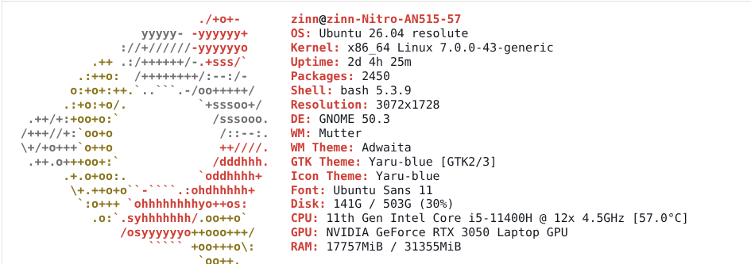
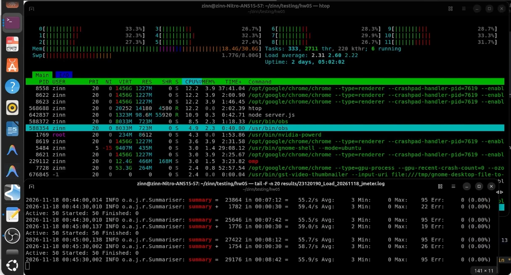
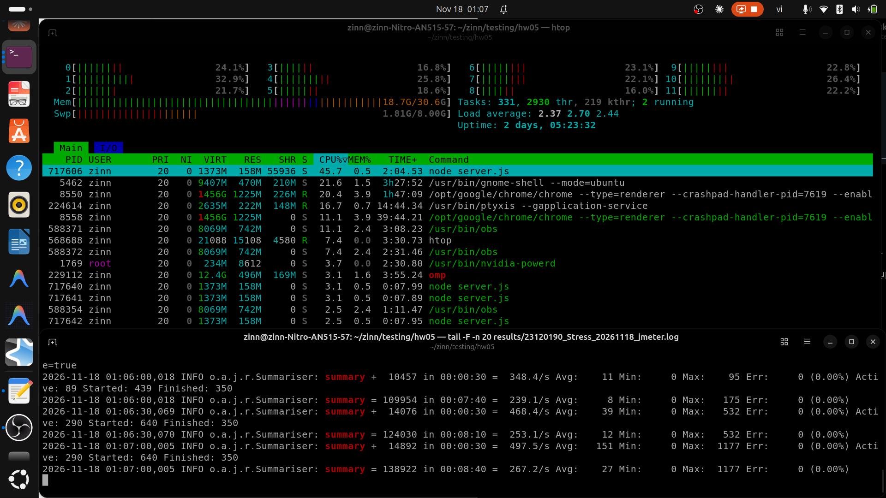
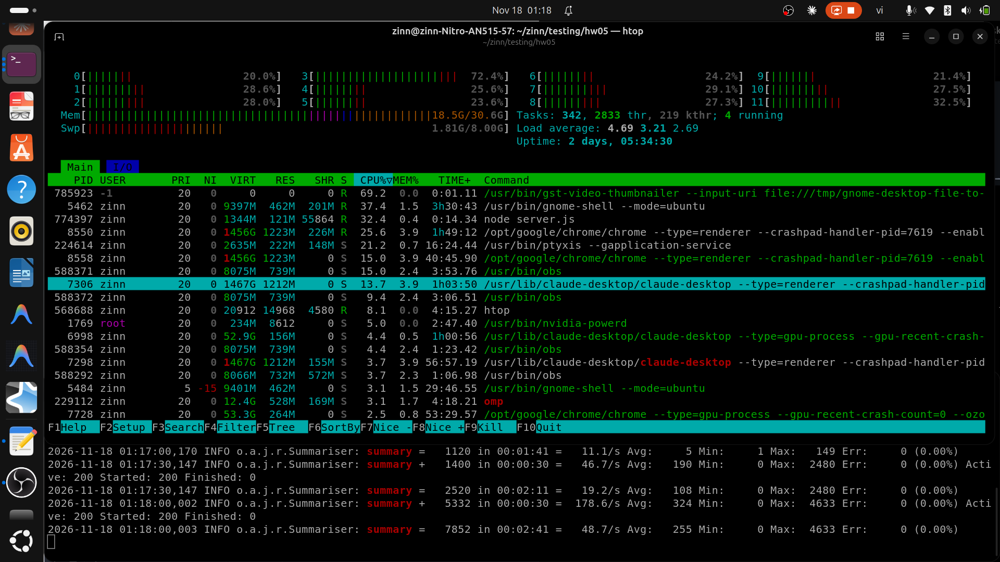
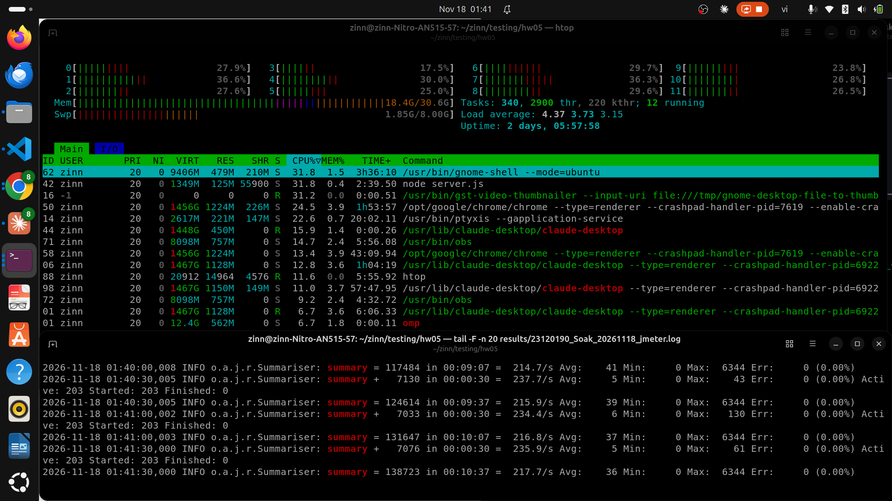

# Task 1 – Báo cáo kiểm thử hiệu năng Flow 1

## 1. Môi trường và phần cứng

Theo [báo cáo phần cứng](05_hardware.md), máy dùng Ubuntu 26.04.1 LTS, Intel Core i5-11400H, 6 nhân / 12 luồng, RAM 30 GiB; JMeter 5.6.3 và Node.js v22.22.1. [Kiểm tra môi trường](00_environment.md) ghi Java mặc định 25 nhưng các lần đo dùng Java 17. JMeter và SUT cùng máy nên có thể tranh chấp tài nguyên; không suy ra năng lực production từ cấu hình này ([thiết kế](02_test_design.md)).

## 2. Workflow và độ phủ

Tất cả plan dùng Flow 1, dữ liệu tài khoản và sản phẩm từ [data](../data/README.md). Chi tiết request, token và assertion ở [phân tích API](01_api_analysis.md) và [thiết kế](02_test_design.md).

| Nhóm | Các endpoint theo thứ tự workflow |
|---|---|
| Auth | `POST /api/login` |
| Read | `GET /api/products` → `GET /api/products/{id}` |
| Transactional | `POST /api/cart` → `GET /api/cart` → `POST /api/checkout` → `GET /api/orders/my-orders` |

## 3. Thiết kế kịch bản

Thông số cấu hình, không phải năng lực đo được: [thiết kế](02_test_design.md).

| Kịch bản | VU / ramp / thời lượng | Think-time | Listener | Plan |
|---|---|---|---|---|
| Load | 50 VU; ramp 50 s; 600 s gồm ramp | 500–1500 ms | Summary Report | [JMX](../test-plans/23120190_Load_20261117.jmx) |
| Stress | Các bậc tuần tự 50, 100, 200, 290 VU; mỗi bậc ramp 30 s, dài 150 s | 250–750 ms | Aggregate Report | [JMX](../test-plans/23120190_Stress_20261117.jmx) |
| Spike | Nền 10 VU / 360 s / ramp 10 s; thêm 190 VU từ giây 120 đến 240, ramp 5 s | 500–1500 ms | Response Time Graph | [JMX](../test-plans/23120190_Spike_20261117.jmx) |
| Soak bổ sung | 203 VU; ramp 60 s; 720 s gồm ramp | 500–1500 ms | Simple Data Writer | [JMX](../test-plans/23120190_Soak_20261118.jmx) |

## 4. AI sai gì và đã sửa gì

Đây là tổng hợp review kỹ thuật của AI, **không thay cho đánh giá của sinh viên**. [Review Load](03_review_load.md) chỉ ra thiếu keep-alive, assertion giỏ có thể khớp item cũ, thiếu pause khi login lỗi và nguy cơ lệch giữa assertion và extractor; [smoke sau sửa](03a_load_fixed_smoke.md) ghi bằng chứng kiểm tra. [Review Stress/Spike](04_review_stress_spike.md) ghi các sửa kế thừa và lỗi `props.get(key, default)` của Groovy có thể ghi default vào properties, thay bằng `getProperty`; [smoke ban đầu](04a_stress_spike_initial_smoke.md), [smoke sau sửa](04b_stress_spike_fixed_smoke.md) và [smoke toàn plan](05a_all_plans_smoke.md) là nguồn bổ sung. Java 25 gặp lỗi tương thích Groovy; dùng Java 17 theo [review](04_review_stress_spike.md) và [môi trường](00_environment.md). Xem riêng [human review do sinh viên viết](06_human_review.md); báo cáo này không điền hoặc suy diễn sự chấp thuận của sinh viên.

Tổng p95 Soak che khuất một phút vượt tiêu chí: xem [phân tích theo phút](08_endurance.md). Trong bước bug report, kết luận checkout/cart HTTP 200 ban đầu không có bằng chứng vì raw cũ thực tế trả 403; Manager sửa quy trình và thu [curl HTTP 200 thực tế](../results/repro/checkout_cart_20261118.txt), xem [bug report](09_bugs.md).

## 5. Kết quả chạy

Bảng dùng entry `Total` của từng statistics JSON, làm tròn RPS đến ba chữ số thập phân. Total gồm cả `Negative login` được assertion chấp nhận; các mẫu luồng chính đều không lỗi theo [run log và phân loại JTL](07_run_log.md). p95 là `pct2ResTime` của HTML, đơn vị ms.

| Run | Tổng samples | Error | p95 ms | RPS | Nguồn JSON | HTML | JTL canonical |
|---|---:|---:|---:|---:|---|---|---|
| Load | 33,775 | 0% | 11 | 56.344 | [JSON](../results/html/23120190_Load_20261118/statistics.json) | [HTML](../results/html/23120190_Load_20261118/index.html) | [JTL](../results/jtl/23120190_Load_20261118.jtl) |
| Stress | 175,882 | 0% | 1,023 | 293.092 | [JSON](../results/html/23120190_Stress_20261118/statistics.json) | [HTML](../results/html/23120190_Stress_20261118/index.html) | [JTL](../results/jtl/23120190_Stress_20261118.jtl) |
| Spike | 27,965 | 0% | 17 | 77.926 | [JSON](../results/html/23120190_Spike_20261118/statistics.json) | [HTML](../results/html/23120190_Spike_20261118/index.html) | [JTL](../results/jtl/23120190_Spike_20261118.jtl) |
| Soak | 158,591 | 0% | 21 | 220.332 | [JSON](../results/html/23120190_Soak_20261118/statistics.json) | [HTML](../results/html/23120190_Soak_20261118/index.html) | [JTL](../results/jtl/23120190_Soak_20261118.jtl) |

HTML Stress gốc đã được JMeter tạo thành công. Worker từng hiểu nhầm thông báo INFO là lỗi; `_recovered` là bản xuất lại từ cùng JTL để đối chiếu, không phải chạy tải lại. Writer phụ Soak ghi cùng sự kiện nên không cộng hai lần; xem [run log](07_run_log.md).

## 6. Lockout và reset

Theo [bằng chứng curl](../results/repro/flow1_bugs_20261118.txt) và [bug report](09_bugs.md), hai lần sai đều trả 401; mật khẩu đúng vẫn trả 403 ở khoảng 35 và 179 giây, đến khoảng 181 giây trả 200. Không diễn giải phép đo thành mốc chính xác tuyệt đối. Plan tách tài khoản login sai, chấp nhận 401/403 theo assertion; trước **mỗi** lần chạy reset bằng [script](../scripts/reset_sut.sh), restart backend, xóa trạng thái DB/giỏ/lockout và seed tài khoản. Chỉ chờ hết khóa không thay reset ([thiết kế](02_test_design.md)).

## 7. Ngưỡng endurance

[JSON phân tích](../results/analysis/endurance.json) và [phương pháp, bảng theo phút](08_endurance.md) loại login sai khỏi luồng chính, dùng p95 nearest-rank và cửa sổ theo thời điểm bắt đầu mẫu. Stress sau ramp quan sát cao nhất **290 VU, 468.556 RPS, p95 947 ms, 0% lỗi**; chưa thấy ngưỡng vượt tiêu chí lỗi >5% hoặc p95 >2.000 ms trong các bậc đã thử. Đây không phải breakpoint hay năng lực tối đa được chứng minh trong 12 phút. Run log nêu **470.775 RPS** cho cửa sổ danh nghĩa khác, bắt đầu theo gate và chia 120 s; không đồng nhất với cửa sổ JSON sau 30 s từ mẫu đầu tiên của bậc ([run log](07_run_log.md), [phương pháp](08_endurance.md)).

Soak 203 VU có phút index 3 (180–240 s từ mẫu chính đầu tiên) **p95 2.244 ms, 171.183 RPS, 0% lỗi**, vượt tiêu chí 2.000 ms dù p95 tổng chỉ 21 ms. Không chứng minh ổn định liên tục suốt 12 phút hay xác định nguyên nhân episode. RSS cực đại quan sát được: Stress **171.64 MiB**, Soak **127.80 MiB**; độ dốc OLS Soak **1.470 MiB/phút**. Đây không phải trần RAM cứng hoặc bằng chứng quyết định của memory leak ([phân tích](08_endurance.md)).

## 8. Bug và issue

[Bug report](09_bugs.md) có **4 bug đã có bằng chứng**: 3 lỗi theo FR-02/FR-08 (lockout, checkout tin tổng tiền client, giỏ không xóa) và BUG-05 về mật khẩu plaintext theo SEC-01 (mục bảo mật tham khảo). Thêm **1 finding Low** về kiểu giá không nhất quán; spec chưa quy định rõ kiểu. [Raw lockout và giá](../results/repro/flow1_bugs_20261118.txt); [raw login/cart/checkout](../results/repro/checkout_cart_20261118.txt). Episode latency là quan sát riêng, không đếm thành bug chức năng. Cả 4 bug, finding Low và 1 vấn đề hiệu năng (Spike) đã được sinh viên đăng tại [GitHub Issues](https://github.com/tzin1401/testing-hw05/issues) (#1–#6); ảnh chụp ở [evidence/issues/](../evidence/issues/).

## 9. Bằng chứng

[Ảnh kết quả Load](../evidence/load_result.png)

[Stress tại 200 VU](../evidence/stress_run_200.png) · [Kết quả Stress](../evidence/stress_result.png)

[Spike phục hồi](../evidence/spike_recovery.png) · [Kết quả Spike](../evidence/spike_result.png)

[Soak tại 6 phút](../evidence/soak_run_6m.png) · [Kết quả Soak](../evidence/soak_result.png)
