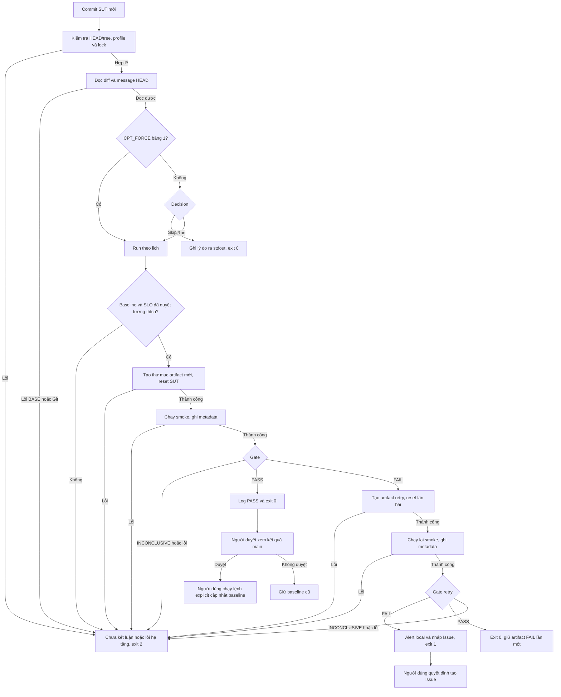

# Task 3 – Continuous Performance Testing: Conclusion

## 1. Tóm tắt mô hình

Mô hình theo dõi thay đổi commit của repo SUT riêng, phân loại diff và message để quyết định chạy hay bỏ qua performance test cho workload API cố định. Khi chạy, pipeline reset SUT, đo Flow 1 bằng JMeter non-GUI và so p95 từng endpoint với baseline tương thích, đồng thời kiểm tra SLO và tỷ lệ lỗi. Kết quả FAIL được chạy lại trước khi phát cảnh báo local; người duyệt quyết định baseline và Issue, AI chỉ hỗ trợ giải thích và soạn nháp. Demo đã chạy thủ công trên commit thật, nhưng CI trên GitHub chưa được triển khai; baseline vận hành và policy các tier sâu chưa được phê duyệt. Nguồn: [đề xuất](16_cpt_proposal.md), [bản đồ thay đổi](16a_sut_change_map.md), [demo](17_cpt_demo.md), [rà soát độc lập](18_task3_check.md).

## 2. Flow chart

Sơ đồ dưới đây sao chép từ [đề xuất §6](16_cpt_proposal.md); nó minh họa smoke, còn các tier theo lịch dùng cùng luồng với plan tương ứng.

## 3. Luật quyết định và luật gate

Theo [đề xuất §2–5](16_cpt_proposal.md) và [bản đồ thay đổi](16a_sut_change_map.md), xét cả đường dẫn cũ và mới khi rename, theo thứ tự: message HEAD có `[perf]` thì chạy; nếu không, `[skip perf]` thì skip; path backend ảnh hưởng hoặc path chưa rõ thì chạy; chỉ frontend hoặc Markdown thì skip cho workload API cố định. `CPT_FORCE=1` ép chạy theo lịch sau các kiểm tra hợp lệ. Marker chỉ đọc message HEAD, do đó có thể bỏ sót thay đổi trước đó trong push nhiều commit; thay đổi seed hoặc môi trường ngoài repo cũng không nhất thiết xuất hiện trong diff.

Gate dùng `load_jtl()` và `metrics()` của [jtl_truth.py](../scripts/jtl_truth.py), nearest-rank, cùng workflow, profile, cửa sổ sau ramp, filter và hardware giữa candidate và baseline. Bảy label chính được xét riêng; Negative login không đưa vào latency Login, và 401/403 được assertion chấp nhận là success. Latency lấy sample bắt đầu sau ramp; error `all` dùng toàn run và từng cửa sổ 120 s sau ramp. Nguồn: [đề xuất §4](16_cpt_proposal.md), [demo §1](17_cpt_demo.md).

- Relative regression khi p95 mới **> 1,20 × baseline và tăng ≥ 5 ms**, với ít nhất 500 sample mỗi label mỗi run và 1.000 sample main tổng mỗi run. Thiếu mẫu hoặc metadata/baseline không tương thích làm phép so sánh tương ứng INCONCLUSIVE.
- SLO FAIL khi p95 hoặc p99 vượt giới hạn của label trong policy đang dùng; smoke/nightly mặc định theo [Task 2 §4](TASK2_REPORT.md). ERROR FAIL khi tỷ lệ `success=false` vượt `error_pct` của policy (mặc định 0,1%) theo mẫu số `all` toàn run hoặc cửa sổ 120 s sau ramp. Một FAIL xác thực không bị điều kiện thiếu mẫu khác che đi; không có FAIL nhưng chưa đánh giá đủ thì INCONCLUSIVE.
- FAIL được reset và retry một lần cùng commit/profile, artifact riêng; chỉ hai FAIL mới xác nhận cảnh báo. Retry PASS trả exit 0 nhưng giữ artifact FAIL đầu; retry INCONCLUSIVE hoặc lỗi hạ tầng không phải PASS. Gate dùng exit 0/1/2 cho PASS/FAIL/INCONCLUSIVE.
- Baseline phải được người duyệt chọn và cập nhật bằng lệnh explicit; bootstrap chỉ kiểm absolute/error/count, chưa có relative gate. Stress, Spike và Soak cần SLO riêng được duyệt trước bootstrap; baseline được tạo từ lượt bootstrap đạt policy rồi được người duyệt chọn trước khi chạy pipeline. Thiếu hoặc không tương thích thì INCONCLUSIVE trước reset/JMeter. Smoke/nightly dùng SLO Task 2 mặc định; chưa đo tier đêm/tuần của CPT. Chi tiết và các giới hạn duyệt vận hành ở [đề xuất](16_cpt_proposal.md) và [rà soát](18_task3_check.md).

## 4. Demo trên commit SUT thật

Nguồn và artifact từng lượt: [demo §1–2](17_cpt_demo.md). Cả bốn JTL thật A, B, D1, D2 dùng Load plan, 30 VU, ramp 15 s, duration 180 s, Negative 5% và reset trước mỗi lượt; C không tạo JTL.

| Kịch bản | Commit SUT | Decision | Gate / exit pipeline | Bằng chứng |
|---|---|---|---|---|
| A – bootstrap trên main | `85af3ba875c88283615e22cb108f13e2fccaf0e9` | Chạy smoke thủ công, không gọi decide | PASS absolute/error/count; chưa có relative gate; tạo baseline thành công | [JTL](../results/cpt/bootstrap_smoke/run.jtl), [baseline/gate](../results/cpt/baseline.json), [execution](../results/cpt/demo_A_execution.json) |
| B – A/A cùng commit | `85af3ba875c88283615e22cb108f13e2fccaf0e9` | run, diff `main^..main` | PASS, exit 0; một attempt, không retry | [JTL](../results/cpt/85af3ba875c8_1/run.jtl), [gate](../results/cpt/85af3ba875c8_1/run_gate.json), [execution](../results/cpt/demo_B_execution.json) |
| C – docs-only | `4506e466a84ec0a25d3397ce8fd234f5d766b872` | skip sau fix lock | SKIP, exit 0; không gọi gate, reset hay JMeter; không có JTL | [execution sau fix](../results/cpt/demo_C_after_fix_execution.json); [lần đầu INCONCLUSIVE do lock](../results/cpt/demo_C_execution.json) |
| D – thêm delay Checkout | `fc8660e7a8c6685cc7ed9c48b84de972d4323677` | run, diff `main..perf-demo/slow-checkout` | Hai attempt FAIL chỉ vì regression p95 Checkout; exit 1 | [D1 JTL](../results/cpt/fc8660e7a8c6_1/run.jtl), [D1 gate](../results/cpt/fc8660e7a8c6_1/run_gate.json), [D2 JTL](../results/cpt/fc8660e7a8c6_2/run.jtl), [D2 gate](../results/cpt/fc8660e7a8c6_2/run_gate.json), [alert](../results/cpt/fc8660e7a8c6_smoke_alert.txt) |

| Label | A p95 (ms) | B p95 (ms) | D1 p95 (ms) | D2 p95 (ms) |
|---|---:|---:|---:|---:|
| 01 Login | 4 | 4 | 4 | 4 |
| 02 Products | 5 | 5 | 4 | 4 |
| 03 Product detail | 4 | 4 | 4 | 4 |
| 04 Add cart | 3 | 3 | 3 | 3 |
| 05 Get cart | 3 | 3 | 3 | 3 |
| 06 Checkout | 23 | 17 | 46 | 45 |
| 07 My orders | 5 | 5 | 5 | 4 |

B không có cảnh báo trong một chiều A/A; D chỉ có relative regression Checkout, không có SLO/error FAIL hoặc regression label khác. Thời gian các khoảng lệnh thực được ghi là 768.980 s; thời gian tường từ đầu A tới hết D và cleanup là 1431.771 s, gồm điều phối/chờ/sửa lỗi. Khoảng D+E 384.618 s đã bao gồm cleanup, không có số E riêng. Nguồn: [demo §2–4](17_cpt_demo.md).

## 5. Trade-off

Bảng từ [đề xuất §8](16_cpt_proposal.md); thời gian scheduler là ước tính chưa tính overhead, không phải thời gian máy đã đo.

| Trade-off | Rủi ro / chi phí | Giảm thiểu |
|---|---|---|
| Chi phí | Ước tính scheduler: mỗi commit được chọn 3 phút, có retry 6 phút; mỗi đêm 10 phút; mỗi tuần 28 phút. Công thức tổng = 3 × số commit chạy + 3 × số retry + 10 × số đêm + 28 × số tuần, phút; chưa tính reset, report, xếp hàng hay chạy release thêm. | Lọc diff, serialize SUT, dùng runner cố định; đo overhead thực tế trước khi lập ngân sách. |
| Báo động giả | Máy dùng chung và nhiễu có thể gây spike dù không đổi code; [Task 2 §2](TASK2_REPORT.md) có cửa sổ Soak 120–240 s p95 all 1.013 ms. [Demo A/A](17_cpt_demo.md): 0 cảnh báo trong 1 chiều so sánh, độ lệch p95 tuyệt đối tối đa 6 ms tại Checkout theo chiều giảm. Đảo baseline B thì A sẽ FAIL; một cặp chưa ước lượng được tỷ lệ báo động giả quần thể. | Đánh giá độ ổn định baseline trước khi bật CI, không chỉ retry candidate; cùng máy/profile/filter và reset. Hai lượt có thể tương quan, không mặc định xác suất cảnh báo bằng bình phương xác suất một lượt. |
| Bỏ sót | Smoke ngắn không xác lập rò rỉ RAM dài hạn; `userCarts` giữ entry sau checkout nhưng chưa chứng minh leak vô hạn ([08](08_endurance.md)). Sàn +5 ms cố ý bỏ qua tăng lớn theo tỷ lệ ở endpoint rất nhanh: **giả định**, không phải số đo, Add cart 3→7 ms vẫn PASS. | Giữ luật đã chốt, ghi rõ độ nhạy và theo dõi endpoint; Soak định kỳ khi có policy phù hợp, điều tra RSS/state và mở rộng workflow. |
| Độ trễ phản hồi dev | Smoke cần ít nhất thời lượng cấu hình 3 phút cộng overhead, hoặc hai lượt khi FAIL; các tầng sâu chờ lịch. | Báo trạng thái sớm, chạy smoke trước và các tầng đêm/tuần bất đồng bộ. |
| Baseline bị trôi | Cập nhật liên tục hoặc so sai profile có thể biến regression thành chuẩn mới. | Lưu commit/metadata, kiểm tra tương thích, cần người duyệt và lệnh explicit; giữ lịch sử artifact để đối chiếu. |

Chiều đảo baseline B → A là hệ quả lý thuyết của luật trên hai số đã đo, không phải lượt JMeter bổ sung. Một baseline bootstrap chưa chứng minh ổn định để bật CI; xem các rủi ro vận hành và điều kiện duyệt trong [rà soát độc lập](18_task3_check.md).

## 6. Nhận định của sinh viên

[Xem nhận định và quyết định của sinh viên](19_human_review_task3.md).
